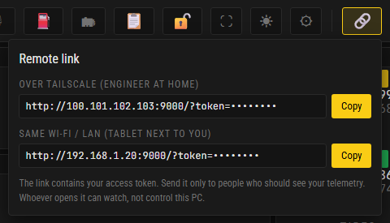
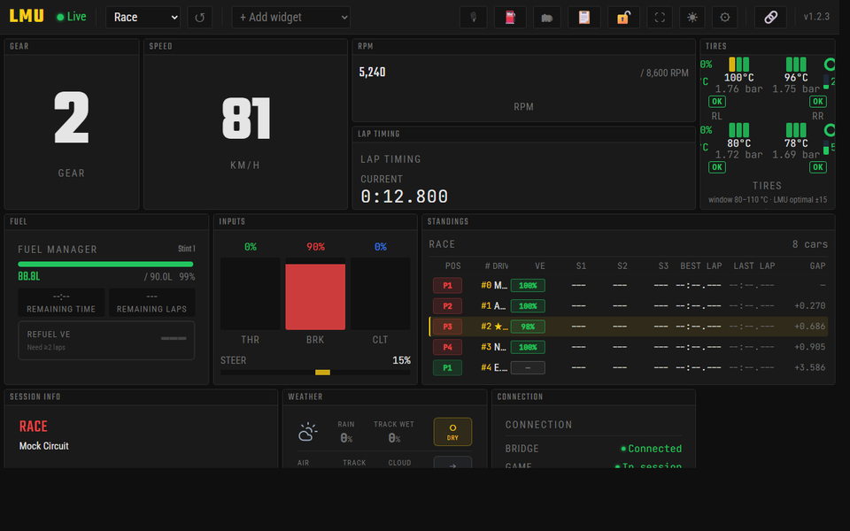

# LMU Pitwall — guida per i piloti

Pitwall legge i dati della tua auto mentre guidi in Le Mans Ultimate
(carburante, energia, gomme, tempi) e li manda all'ingegnere, che segue la gara
dal suo PC. Non tocca la guida e non cambia nulla nel gioco: legge e basta.

## Una volta sola (10 minuti)

### 1. Tailscale

È il collegamento privato tra il tuo PC e quello dell'ingegnere.

1. Scarica Tailscale da [tailscale.com/download](https://tailscale.com/download),
   installalo e accedi (va bene il tuo account Google o Microsoft).
2. Apri [login.tailscale.com/admin/machines](https://login.tailscale.com/admin/machines).
   Accanto al nome del tuo PC premi **⋯** → **Share…**, copia il link di
   invito e mandalo all'ingegnere.

L'ingegnere vede solo il tuo PC, non il resto della tua rete.

### 2. Pitwall

1. Avvia il file `LMU-Pitwall-Setup-….exe` che ti ha mandato l'ingegnere.
2. Se Windows scrive *"Windows ha protetto il PC"*: premi **Ulteriori
   informazioni** → **Esegui comunque**. Lo fa con tutti i programmi senza
   firma digitale.
3. Alla domanda *"Consentire a questa app di apportare modifiche?"* rispondi
   **Sì**: serve per aprire il firewall solo verso Tailscale e la rete di casa.
4. Lascia le opzioni come sono. Se non vuoi ricordarti di aprirlo prima di
   ogni gara, spunta **Avvia Pitwall con Windows**.

### 3. Le Mans Ultimate

Nel gioco: **Settings → Gameplay → Enable Plugins** su **On**, poi chiudi e
riapri il gioco. Senza questo Pitwall non riceve niente.

### 4. Il link per l'ingegnere

Apri **LMU Pitwall** dal menu Start: si apre una pagina nel browser. In alto
a destra premi **🔗**, poi **Copy** accanto a **Over Tailscale** e manda il
link all'ingegnere.

Il link contiene una chiave personale: mandalo solo all'ingegnere. Chi lo ha
può guardare i tuoi dati, ma non comandare il tuo PC. Non cambia, quindi
basta mandarlo una volta.

## A ogni gara

- **Prima di salire in macchina** apri **LMU Pitwall** (non serve se hai scelto
  l'avvio con Windows). La pagina del browser puoi chiuderla: Pitwall resta
  acceso senza finestre. Riaprendo l'icona torna la pagina.
- Se nella pagina in alto a sinistra c'è **● Live**, l'ingegnere ti vede.

- Pitwall si chiude da solo 10 minuti dopo che hai chiuso il gioco.

## Se qualcosa non va

| Cosa succede | Cosa fare |
|---|---|
| L'ingegnere non ti vede | Controlla che Tailscale sia acceso (icona vicino all'orologio) e che Pitwall sia aperto |
| La pagina dice che il gioco non c'è | Apri LMU; se è aperto, controlla *Enable Plugins* (punto 3) |
| Arriva una versione nuova | Avvia il nuovo `Setup`: sostituisce la vecchia e tiene le impostazioni |
| Vuoi toglierlo | Impostazioni di Windows → App → **LMU Pitwall** → Disinstalla |
